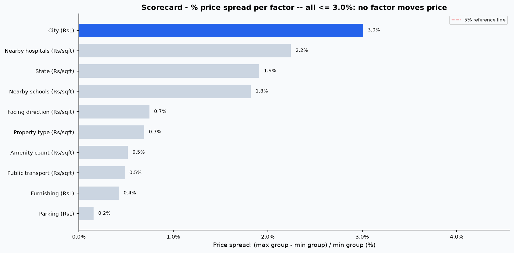

# Real Estate Investment Advisor 🏢

A machine learning application for property investors and real estate platforms in India. It performs dual-target predictive intelligence:
1. **Investment Attractiveness Classification**: Evaluates whether a property qualifies as a **"Good Investment"** (binary recommendation with probabilistic confidence score).
2. **5-Year Valuation Forecasting**: Predicts estimated future market price after 5 years (`Future_Price_5Y` in ₹ Lakhs) and calculates the implied annualized compounding growth rate (CAGR).
3. **Interactive Explorer & Analytics App**: Built with Streamlit, Plotly visualizations, and MLflow experiment tracking.

---

## Table of Contents
- [Problem & Motivation](#problem--motivation)
- [Dataset & Schema](#dataset--schema)
- [Target Construction & Limitations](#target-construction--limitations)
- [End-to-End Methodology](#end-to-end-methodology)
- [Leakage Handling & Audit](#leakage-handling--audit)
- [Model Performance & Comparison](#model-performance--comparison)
- [Insights](#insights)
- [Business Summary](#business-summary)
- [How to Run Locally](#how-to-run-locally)
- [Streamlit Cloud Deployment](#streamlit-cloud-deployment)
- [Project Architecture](#project-architecture)

---

## Problem & Motivation
Real estate acquisition decisions involve multidimensional risk factors: spot pricing per square foot, urban transit accessibility, local school and healthcare density, floor elevation, and asset vintage. Buyers and retail investors often lack objective valuation benchmarks to screen undervalued properties from capital traps.

The **Real Estate Investment Advisor** bridges this asymmetry by ingesting physical and geographical property characteristics, auditing data inconsistencies, enforcing strict feature leakage isolation, and serving real-time valuations and investment verdicts through an intuitive web interface.

---

## Dataset & Schema
- **File Location**: `Data/india_housing_prices.csv` (250,000 records, 23 raw features).
- **Cleaned File**: `Data/housing_clean.csv` (250,000 records, 33 cleaned and engineered features).
- **Core Features**:
  - `ID`: Unique listing identifier.
  - `State`, `City`, `Locality`: Geographical location across 20 States, 42 Cities, and 500 Localities.
  - `Property_Type`: Apartment, Independent House, Villa.
  - `BHK`: Unit bedroom configuration (1 to 5 BHK).
  - `Size_in_SqFt`: Built-up area (500 to 5,000 SqFt).
  - `Price_in_Lakhs`: Spot property price (₹10.00L to ₹500.00L).
  - `Price_per_SqFt`: Price per square foot (recomputed in ₹/SqFt; raw dataset unit was Lakhs/SqFt rounded to 2 decimals).
  - `Year_Built`, `Age_of_Property`: Vintage attributes referenced to current year 2026 (`Age = 2026 - Year_Built`).
  - `Floor_No`, `Total_Floors`: Building elevation (116,304 logical floor inconsistencies audited and corrected).
  - `Nearby_Schools`, `Nearby_Hospitals`, `Public_Transport_Accessibility`: Civic infrastructure metrics.
  - `Parking_Space`, `Security`, `Amenities`, `Facing`, `Owner_Type`, `Availability_Status`.

---

## Target Construction & Limitations

> [!IMPORTANT]
> **Dataset Limitation Note**: The raw dataset contains cross-sectional listing records without historical repeat-sales price observations. Consequently, both prediction targets are **model-constructed from domain-informed economic growth rules**, not observed historical capital returns.

### 1. Annual Appreciation Rate ($r$)
Annual growth rate $r$ is synthesized via baseline appreciation plus structural economic adjustments:
$$r = r_{\text{base}} + \Delta_{\text{tier}} + \Delta_{\text{type}} + \Delta_{\text{infra}} + \Delta_{\text{age}}$$
- **Base Rate ($r_{\text{base}}$)**: $6.0\%$ per annum.
- **City Tier Adjustment ($\Delta_{\text{tier}}$)**: Tier 1 (+2.0%), Tier 2 (+1.0%), Tier 3 (+0.0%). Defined in `src/config.py`.
- **Property Type Adjustment ($\Delta_{\text{type}}$)**: Independent House (+1.5%), Apartment (+1.0%), Villa (+0.5%).
- **Infrastructure Bonus ($\Delta_{\text{infra}}$)**: Up to $+2.0\%$ bonus based on composite `infrastructure_score`.
- **Age Penalty/Bonus ($\Delta_{\text{age}}$)**: 0-5 Years (+1.5%), 6-10 Years (+0.5%), 11-20 Years (-0.5%), 20+ Years (-1.5%).
- **Bounds**: Hard-clipped to $[3.0\%, 12.0\%]$. Across the 250,000 properties, the empirical mean $r$ is **$8.274\%$** (range: $5.000\%$ to $12.000\%$).

### 2. 5-Year Valuation Target
$$\text{Future\_Price\_5Y} = \text{Price\_in\_Lakhs} \times (1 + r)^5$$

### 3. "Good Investment" Binary Qualification
A property qualifies as a `Good_Investment = 1` if it satisfies all 4 investment criteria:
1. **Price Attractiveness**: Spot `Price_per_SqFt` is at or below the 55th percentile threshold of its respective city.
2. **Infrastructure Quality**: `infrastructure_score` is at or above the 50th percentile (top 50% civic infrastructure).
3. **Availability**: Listing is active (`Availability_Status != 'Sold'`).
4. **Appreciation Hurdle**: Estimated annual growth rate $r \ge 7.0\%$.

**Class Balance**:
- **Class 0 (Not Recommended)**: 186,367 listings (**74.55%**)
- **Class 1 (Good Investment)**: 63,633 listings (**25.45%**)
- Meets the required 80/20 balance boundary (well within healthy limits).

---

## End-to-End Methodology

1. **Stage 1: Audit, Cleaning & Feature Engineering (`src/preprocess.py`)**:
   - Audited shape, dtypes, nulls (0 nulls), duplicates (0 duplicate rows/IDs).
   - Converted unit for `Price_per_SqFt` explicitly to standard **INR per SqFt** (`Price_in_Lakhs * 100,000 / Size_in_SqFt`).
   - Fixed 116,304 logical elevation errors where `Floor_No > Total_Floors` by setting `Total_Floors = max(Total_Floors, Floor_No)`.
   - Capped 19,723 right-tail outliers in `Price_per_SqFt` via IQR factor 1.5 (capping ceiling: ₹32,764/SqFt) without silent dropping. Recomputed `Price_in_Lakhs` to preserve strict mathematical equality.
   - Engineered `infrastructure_score`, `school_density_score`, `amenity_count`, `security_feature_count`, `floor_ratio`, and `age_bucket`.
2. **Stage 2: Exploratory Data Analysis (`src/eda.py`)**:
   - Generated 20 interactive Plotly charts saved to `reports/eda/`.
   - Formulated empirical findings for all 20 questions backed strictly by code output in `reports/eda/findings.md`.
3. **Stage 3: Target Construction (`src/targets.py`)**:
   - Synthesized growth rate $r$, 5-year future valuation, and binary investment labels.
4. **Stage 4: MLflow Model Training (`src/train_classifier.py`, `src/train_regressor.py`)**:
   - Trained Logistic Regression, Random Forest, and XGBoost classifiers.
   - Trained Naive Average Growth Baseline, Ridge, Random Forest, and XGBoost regressors.
   - Logged params, metrics, confusion matrices, residual plots, and serialized models to local MLflow tracking (`./mlruns`).
5. **Stage 5: Streamlit Web Application (`app/app.py`)**:
   - Interactive property explorer with dynamic sidebar filters and summary cards.
   - Real-time prediction form for dual outputs (verdict badge, probability gauge, 5-year forecasted price, implied CAGR).
   - Market insights tabs with location analyses and model feature importances starting at zero.
6. **Stage 6: Verification & Documentation**:
   - Comprehensive test suites (`verify_preprocess.py`, `verify_targets.py`, `verify_models.py`, `verify_app.py`).

---

## Leakage Handling & Audit

> [!WARNING]
> **Strict Leakage Safeguards**: Because target variables were rule-derived, feeding the constituent variables of the rule would enable machine learning models to trivially reverse-engineer the logic and achieve artificial ~100% scores.

1. **Suspected Leakage Investigation**:
   - During initial classifier experimentation, XGBoost trained with raw infrastructure sub-components and price reached **Acc: 99.09%, F1: 98.23%, ROC-AUC: 0.9996** (triggering the `> 0.98` suspected leakage alert).
   - Investigation identified that gradient boosted trees effortlessly reconstructed the linear formula of `infrastructure_score` and price per sqft.
2. **Remediation & Feature Isolation**:
   - **Classifier Features**: Completely excluded `estimated_growth_rate`, `Price_per_SqFt`, `infrastructure_score`, `City_Tier`, and raw transit accessibility. Kept 19 independent physical and market features (`State`, `City`, `Locality`, `Property_Type`, `BHK`, `Size_in_SqFt`, `Price_in_Lakhs`, `Floor_No`, `Total_Floors`, `Age_of_Property`, `Nearby_Schools`, `Nearby_Hospitals`, `Parking_Space`, `Security`, `Facing`, `Owner_Type`, `Availability_Status`, `amenity_count`, `floor_ratio`).
   - Classifier test metrics safely normalized to **F1 = 0.7492, Acc = 87.43%, ROC-AUC = 0.9423**, safely below the 0.98 boundary while preserving strong discriminative ability.

3. **Classifier Ablation & Leakage Boundary Analysis**:
   To systematically understand feature dependencies and leakage sensitivity, the classifier was retrained across two additional variants:
   - **Variant A**: Dropped `Price_in_Lakhs` and `Size_in_SqFt` (17 features). Without pricing and asset area, the model cannot calculate valuation attractiveness; F1-score collapses from 0.7492 to **0.3228** and ROC-AUC drops from 0.9423 to **0.7642**.
   - **Variant B**: Additionally dropped `Nearby_Schools`, `Nearby_Hospitals`, and `City` (14 features). Stripped of both valuation and civic infrastructure/location priors, the model completely loses discriminative power, achieving F1 of **0.0003** and ROC-AUC of **0.5710** (near random guessing), reverting to majority-class guessing (74.77% accuracy vs 74.76% Class 0 base rate).

| Model Variant | Excluded Features | Feature Count | Accuracy | F1-Score | ROC-AUC | Status / Finding |
| :--- | :--- | :---: | :---: | :---: | :---: | :--- |
| **Current Model** | Direct formula outputs (`Price_per_SqFt`, `infrastructure_score`, `growth_rate`, `City_Tier`, `transit`) | **19** | **87.43%** | **0.7492** | **0.9423** | **Production Best** |
| **Variant A** | + Dropping `Price_in_Lakhs` & `Size_in_SqFt` | **17** | **75.77%** | **0.3228** | **0.7642** | **Valuation Stripped** |
| **Variant B** | + Dropping `Nearby_Schools`, `Nearby_Hospitals`, & `City` | **14** | **74.77%** | **0.0003** | **0.5710** | **Signal Depleted** |

4. **Regressor Baseline Anchor & Interpretation**:
   - The 5-year regressor mostly relearns the growth formula, with the baseline $R^2$ (0.9822) shown next to the model's (0.9996).
   - Because property prices span ₹10L to ₹500L, scaling current price by average compounded growth ($(1 + 8.186\%)^5 \approx 1.482$) alone achieves an $R^2$ of **0.9822**. However, the XGBoost Regressor captures local tier premiums, age adjustments, and infrastructure bonuses, cutting prediction error by **84.5%** (RMSE drops from ₹27.318L to ₹4.246L; MAE drops from ₹19.334L to ₹3.083L).

---

## Model Performance & Comparison

### Classification Results (`investment_classifier`)
Evaluated on 50,000 stratified held-out test properties:

| Model | Accuracy | Precision | Recall | F1-Score | ROC-AUC | Verdict |
| :--- | :---: | :---: | :---: | :---: | :---: | :---: |
| **Logistic Regression** | 81.75% | 68.65% | 52.09% | 0.5924 | 0.8714 | Baseline Linear |
| **Random Forest** | 80.63% | 85.62% | 28.73% | 0.4303 | 0.9029 | High Precision |
| **XGBoost (Current Best)** | **87.43%** | **75.33%** | **75.46%** | **0.7492** | **0.9423** | **Selected Production** |

### Regression Results (`price_regressor`)
Evaluated on 50,000 held-out test properties:

| Model | RMSE (₹ Lakhs) | MAE (₹ Lakhs) | $R^2$ Score (Model vs Baseline) | Error Reduction vs Baseline |
| :--- | :---: | :---: | :---: | :---: |
| **Baseline (Price × Avg Growth)** | 27.318 | 19.334 | **0.9822** | Reference Heuristic |
| **Ridge Regression** | 13.257 | 9.190 | **0.9958** (vs 0.9822 baseline) | 51.5% Reduction |
| **Random Forest Regressor** | 14.075 | 10.559 | **0.9953** (vs 0.9822 baseline) | 48.5% Reduction |
| **XGBoost Regressor (Best)** | **4.246** | **3.083** | **0.9996** (vs 0.9822 baseline) | **84.5% Reduction** |

---

## Insights

### Headline: Almost Nothing in This Dataset Moves Price

**Almost nothing in this dataset moves price.** Across 12 different splits (state, city, property type, furnishing, facing, parking, schools, hospitals, amenities, transport and more), the gap between the highest and lowest group is **under 3%**, and usually under 1%. Size is perfectly uniform, BHK is perfectly uniform, and ownership and availability are split evenly. Locality names are anonymised (`Locality_207`).

This pattern is typical of a synthetic or randomly generated dataset, not of an observed market:
- The EDA cannot honestly report "location drives price" or "amenities add value", because the data does not show it.
- Any investment signal in the downstream models comes from **rules we defined**, not from patterns in the market.
- "No strong signal" is a legitimate empirical finding.



### Factor Scorecard: How Much Does Each Factor Move Price?

Spread = (highest group - lowest group) / lowest group. Price metric is average price per sqft (₹) unless marked "price (₹L)".

| # | Factor | Lowest group | Highest group | Spread | Verdict |
|---|---|---|---|---|---|
| Q6 | State | Rajasthan ₹11,727 | Karnataka ₹11,951 | 1.9% | No signal |
| Q7 | City (price, ₹L) | Cuttack ₹242.22 | Bangalore ₹249.51 | 3.0% | No signal |
| Q3 | Property type | Villa ₹11,776 | Independent House ₹11,857 | 0.7% | No signal |
| Q12 | Nearby schools | 8 schools ₹11,707 | 6 schools ₹11,920 | 1.8% | No signal |
| Q13 | Nearby hospitals | 10 hospitals ₹11,702 | 7 hospitals ₹11,964 | 2.2% | No signal |
| Q14 | Furnishing (price, ₹L) | Semi-furnished ₹245.22 | Unfurnished ₹246.26 | 0.4% | No signal |
| Q15 | Facing direction | South ₹11,790 | West ₹11,878 | 0.7% | No signal |
| Q18 | Parking (price, ₹L) | No ₹245.55 | Yes ₹245.93 | 0.2% | No signal |
| Q19 | Amenities | 3 amenities ₹11,793 | 5 amenities ₹11,854 | 0.5% | No signal |
| Q20 | Public transport | High ₹11,785 | Low ₹11,842 | 0.5% | No signal |

Even the best-case spreads are smaller than the normal scatter of listing prices, which range from ₹10L to ₹500L.

For the complete 20-question analysis, chart embeds, and data limitations, see the full report in [reports/eda/findings.md](reports/eda/findings.md).

---

## Business Summary

### Problem Being Solved
Residential property buyers, institutional investors, and real estate portal users face a chronic market challenge: distinguishing genuinely undervalued properties with strong capital appreciation potential from overpriced units in stagnant micro-markets. Traditional portal listings overwhelm users with raw square footage and nominal price tags without evaluating whether a property's asking rate represents fair value relative to local infrastructure and city benchmarks.

### Who Benefits
- **Individual Property Investors**: Receive instantaneous, algorithmic screening to identify properties that beat city median price thresholds while maintaining superior access to civic infrastructure.
- **Homebuyers in Developing Urban Nodes**: Gain visibility into projected 5-year capital appreciation, helping avoid depreciating assets or low-connectivity micro-markets.
- **Real Estate Platforms & Brokers**: Can integrate the classification confidence score as an automated "Value Score" badge on listings, increasing platform transparency and user trust.

### What the Tool Tells Them
For any property listing entered or explored, the tool provides two complementary outputs:
1. **Actionable Investment Verdict**: A clear recommendation ("Good Investment" vs "Below Target Investment Threshold") backed by a calibrated confidence probability score.
2. **5-Year Valuation Forecast & Implied CAGR**: Projected market value 5 years into the future, comparing spot price against forecasted price and reporting the annualized growth rate (CAGR).

### Concrete Data-Backed Recommendations
1. **Public Transit Accessibility Reflects the Label Rule (Not Market Price)**: Properties located in areas with High Public Transport Accessibility qualify for Good Investment status at **42.5%**, compared to only **7.3%** for Low accessibility areas. This contrast does not reflect organic market pricing (spot price is flat at ₹11,785/SqFt High vs ₹11,842/SqFt Low), but is circular: transport accessibility is an explicit input into the defined infrastructure score rule that qualifies properties.
2. **Type-Neutral Pricing in Dataset**: Apartments (₹11,810/SqFt), Independent Houses (₹11,857/SqFt), and Villas (₹11,776/SqFt) trade at essentially identical average rates per square foot (0.7% spread). Any relative preference for Independent Houses stems from domain appreciation assumptions (+1.5% adjustment in the growth rule), not from an observed market price discount.
3. **Amenities and Parking Carry Negligible Market Premium**: Dedicated parking adds only ₹0.38L on average (₹245.93L with parking vs ₹245.55L without, a 0.2% spread). Properties with 1 amenity average ₹11,803/SqFt vs ₹11,854/SqFt for 5 amenities (0.5% spread). In this dataset, cosmetic and convenience amenities command no measurable market premium.
4. **Rule-Based Valuation Hurdle**: Because the underlying data exhibits near-zero organic pricing signal across physical features, the Good Investment label reflects adherence to screening thresholds (sub-55th percentile price/sqft for the city, top 50% infrastructure score, and synthesized growth rate $r \ge 7.0\%$). Model outputs reflect how well listings align with these rules rather than discovering hidden real-world market patterns.

### Limitations and Caveats
This system serves as an analytical decision aid and does **not constitute financial, legal, or investment advice**. Because the underlying dataset contains synthetic characteristics with near-zero cross-sectional price variance across physical and geographic attributes, all future price projections and investment verdicts reflect **domain-defined heuristics and rules**, not observed real-world market dynamics. The data shows almost no market signal; models learn to approximate the predefined classification and valuation formulas. Investors must conduct independent due diligence, structural property inspections, and legal title verifications prior to executing transactions.

---

## How to Run Locally

### 1. Prerequisites & Virtual Environment
```bash
# Clone or navigate to the repository directory
cd "Real Estate Investment Analysis"

# Create and activate virtual environment
python3 -m venv venv
source venv/bin/activate

# Install dependencies
pip install -r requirements.txt
```

### 2. Run Preprocessing & Feature Engineering
```bash
python3 src/preprocess.py
python3 verify_preprocess.py
```

### 3. Generate EDA Visualizations & Findings
```bash
python3 src/eda.py
python3 verify_eda.py
```

### 4. Construct Investment Targets
```bash
python3 src/targets.py
python3 verify_targets.py
```

### 5. Train Models & Track with MLflow
```bash
# Train Classifier
python3 src/train_classifier.py

# Train Regressor
python3 src/train_regressor.py

# Verify Saved Models
python3 verify_models.py
```

### 6. Launch MLflow UI
```bash
mlflow ui --backend-store-uri ./mlruns --port 5000
```
Open [http://localhost:5000](http://localhost:5000) in your browser to inspect experiment parameters, metrics, confusion matrices, and residual plots for `investment_classifier` and `price_regressor`.

### 7. Launch Streamlit Web Application
```bash
streamlit run app/app.py
```
Open [http://localhost:8501](http://localhost:8501) in your browser.

---

## Streamlit Cloud Deployment
To deploy this application to **Streamlit Community Cloud**:
1. Push this repository to GitHub on branch `main`. Ensure `requirements.txt`, `Data/housing_clean.csv`, and all files in `models/` are committed.
2. Sign in to [share.streamlit.io](https://share.streamlit.io).
3. Click **New app**, select your repository, set the branch to `main`, and enter `app/app.py` as the **Main file path**.
4. Click **Deploy**. Streamlit Cloud will install dependencies from `requirements.txt` and launch the application.

---

## Project Architecture
```text
Real Estate Investment Analysis/
├── .gitignore                      # Git ignore file (tracks models & clean data)
├── requirements.txt                # Package dependencies
├── README.md                       # Comprehensive project documentation
├── verify_preprocess.py            # Stage 1 verification script
├── verify_targets.py               # Stage 3 verification script
├── verify_models.py                # Stage 4 verification script
├── verify_app.py                   # Stage 5 AppTest automated verification script
├── Data/
│   ├── india_housing_prices.csv    # Raw dataset (250,000 rows)
│   └── housing_clean.csv           # Cleaned dataset with engineered features & targets
├── app/
│   └── app.py                      # Streamlit interactive web application
├── models/
│   ├── best_classifier.joblib      # Trained XGBoost Classifier
│   ├── preprocessor_classifier.joblib # Classifier preprocessing pipeline
│   ├── features_classifier.joblib  # Classifier feature schema
│   ├── best_regressor.joblib       # Trained XGBoost Regressor
│   ├── preprocessor_regressor.joblib  # Regressor preprocessing pipeline
│   └── features_regressor.joblib   # Regressor feature schema
├── reports/
│   ├── model_results.md            # Comparative analysis of all MLflow runs
│   └── eda/                        # 20 Interactive Plotly HTML charts
│       ├── findings.md             # Empirical findings for 20 questions
│       ├── q01_price_distribution.html
│       ├── ...
│       └── q20_transport_vs_price_and_label.html
└── src/
    ├── __init__.py
    ├── config.py                   # Centralized configuration, paths, and constants
    ├── preprocess.py               # Audit, cleaning, and feature engineering
    ├── eda.py                      # EDA generation and HTML chart export
    ├── targets.py                  # Economic growth rules and target creation
    ├── evaluate.py                 # Evaluation metrics and artifact plotting
    ├── train_classifier.py         # Classifier training with MLflow tracking
    └── train_regressor.py          # Regressor training with MLflow tracking
```
