# Exploratory Data Analysis: Real Estate Investment Advisor

**Dataset:** `india_housing_prices.csv`, 250,000 listings after cleaning (`Data/housing_clean.csv`).
**Scope:** the 20 EDA questions from the project brief, grouped into four themes. Every figure below is taken from the computed EDA output.

---

## 1. Headline

**Almost nothing in this dataset moves price.** Across 12 different splits (state, city, property type, furnishing, facing, parking, schools, hospitals, amenities, transport and more), the gap between the highest and lowest group is **under 3%**, and usually under 1%. Size is perfectly uniform, BHK is perfectly uniform, ownership and availability are split evenly. Locality names are anonymised (`Locality_207`).

This pattern is typical of a synthetic or randomly generated dataset, not of an observed market. It is the single most important thing to know before reading anything else in this project:

- The EDA cannot honestly report "location drives price" or "amenities add value", because the data does not show it.
- Any investment signal in the later models comes from **rules we defined**, not from patterns in the market.
- "No strong signal" is a legitimate finding, and the sections below report it as one.

---

## 2. Scorecard: how much does each factor move price?

Spread = (highest group - lowest group) / lowest group. Price metric is average price per sqft (₹) unless marked "price (₹L)".

| # | Factor | Lowest group | Highest group | Spread | Verdict |
|---|---|---|---|---|---|
| Q6 | State | Rajasthan ₹11,727 | Karnataka ₹11,951 | 1.9% | No signal |
| Q7 | City (price, ₹L) | Cuttack ₹242.22 | Bangalore ₹249.51 | 3.0% | No signal |
| Q3 | Property type | Villa ₹11,776 | Independent House ₹11,857 | 0.7% | No signal |
| Q12 | Nearby schools | 8 schools ₹11,707 | 6 schools ₹11,920 | 1.8% | No signal |
| Q13 | Nearby hospitals | 10 hospitals ₹11,702 | 7 hospitals ₹11,964 | 2.2% | No signal |
| Q14 | Furnishing (price, ₹L) | Semi-furnished ₹245.22 | Unfurnished ₹246.26 | 0.4% | No signal |
| Q15 | Facing direction | South ₹11,790 | West ₹11,878 | 0.7% | No signal |
| Q18 | Parking (price, ₹L) | No ₹245.55 | Yes ₹245.93 | 0.2% | No signal |
| Q19 | Amenities | 3 amenities ₹11,793 | 5 amenities ₹11,854 | 0.5% | No signal |
| Q20 | Public transport | High ₹11,785 | Low ₹11,842 | 0.5% (slightly negative) | No signal |

Even the best-case spreads are smaller than the normal scatter of listing prices, which range from ₹10L to ₹500L.

---

## 3. Findings by theme

### A. Price and size (Q1-Q5)

#### Q1: Price Distribution
Mean ₹245.74L, median ₹240.02L, std ₹136.14L, range ₹10L-₹500L. Broad and roughly flat across the range, not bell-shaped.

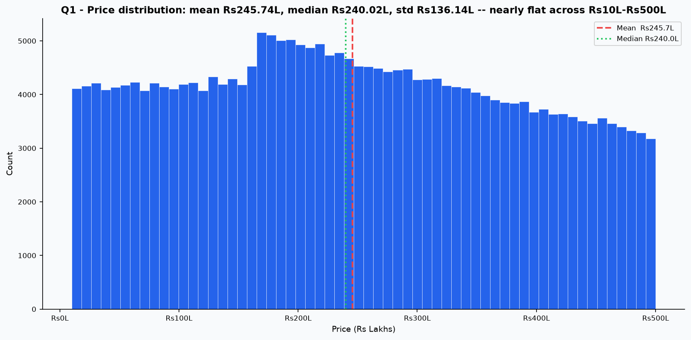

#### Q2: Size Distribution
500-5,000 sqft, mean 2,749.8, median 2,747.0. Essentially a perfect uniform spread.

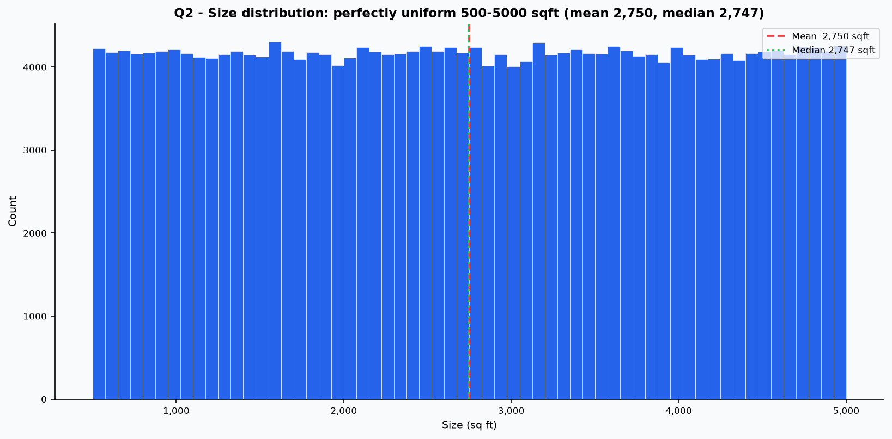

#### Q3: Price per SqFt by Property Type
Apartment ₹11,810, Independent House ₹11,857, Villa ₹11,776. Spread 0.7% — no type premium.

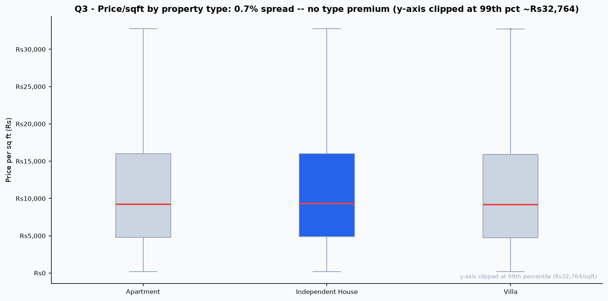

#### Q4: Size vs Price
Pearson r = 0.097. Weak, positive and nearly negligible. Larger homes are not meaningfully pricier, which real markets would contradict.

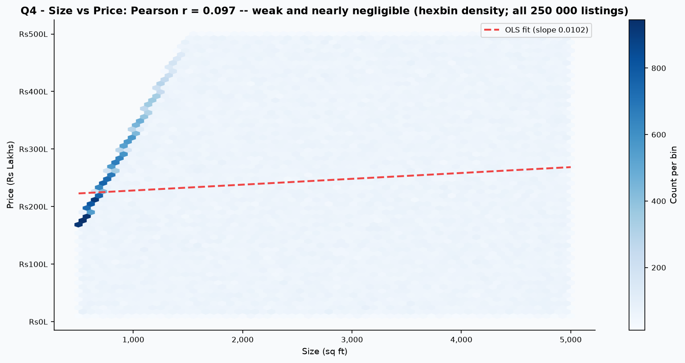

#### Q5: Outliers
In the raw data, 19,723 listings (7.89%) exceed the IQR cap of ₹32,764/sqft and were capped during preprocessing (0 remain above the cap in the cleaned dataset); zero size outliers.

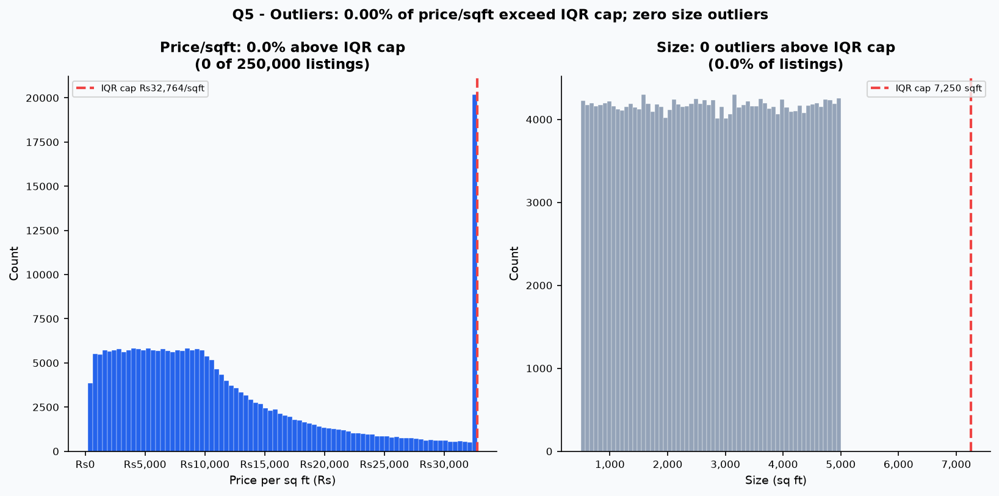

**Why Q5 matters:** price and size are close to independent uniform draws, so *price ÷ size* produces a heavy right tail mechanically. A ₹450L listing of 600 sqft lands far above the cap. These "outliers" are an artefact of dividing two unrelated variables, not luxury properties, and they were capped rather than dropped.

### B. Location (Q6-Q10)

#### Q6: Price per SqFt by State
₹11,727 (Rajasthan) to ₹11,951 (Karnataka). 1.9% spread.

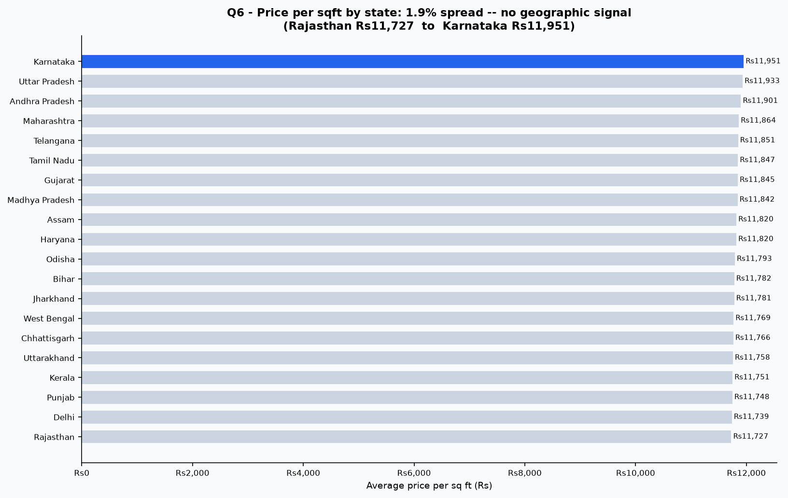

#### Q7: Average Price by City
₹242.22L (Cuttack) to ₹249.51L (Bangalore). Every city clusters around ₹245.81L.

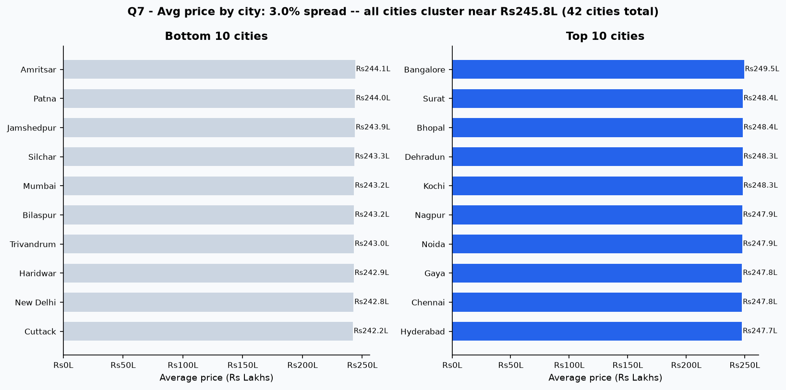

#### Q8: Median Property Age by Locality
Median age 18-21 years in the top 20 localities (overall median 19).

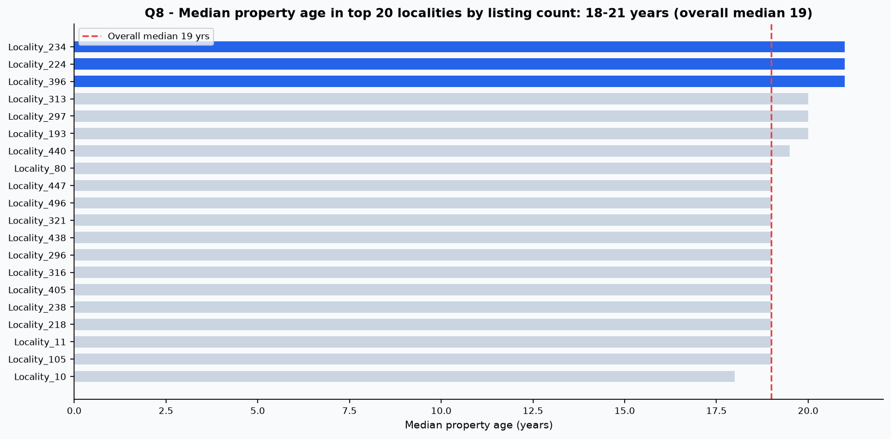

#### Q9: BHK Mix Across Cities
1 BHK 20.1%, 2 BHK 19.9%, 3 BHK 20.0%, 4 BHK 19.9%, 5 BHK 20.1%. Perfectly even.

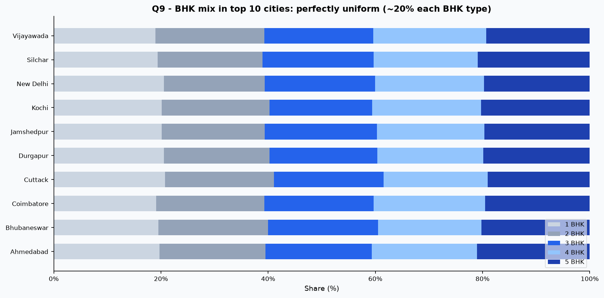

#### Q10: Price Trend for Top Localities
The top locality (Locality_207) averages ₹13,048/sqft. Across build years 1990-2023, pricing fluctuates with no vintage appreciation trend.

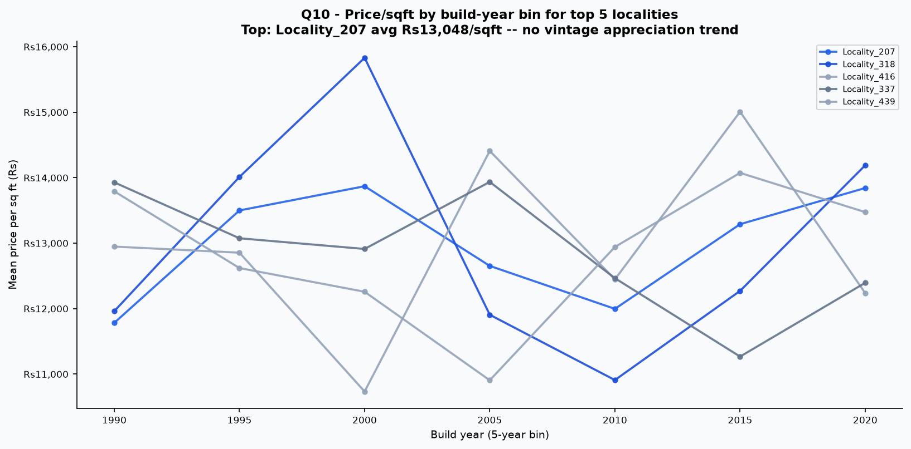

Bangalore topping the city list and Cuttack trailing is a 3% difference, so treat the ranking as noise rather than a market ordering.

### C. Feature relationships (Q11-Q15)

#### Q11: Feature Correlation Heatmap
Strongest pair is Price vs Future_Price_5Y (r = 0.992), which is **by construction**, since the future price is today's price grown by a rule. Physical attributes show |r| < 0.05 with each other.

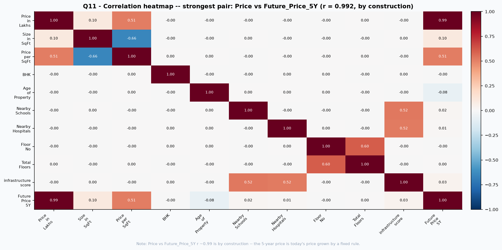

#### Q12: Nearby Schools vs Price
r = -0.0019. Flat across school counts (₹11,841 for 1 school vs ₹11,794 for 10 schools, 0.4% spread; across all counts 1-10 the full factor spread is 1.8%).

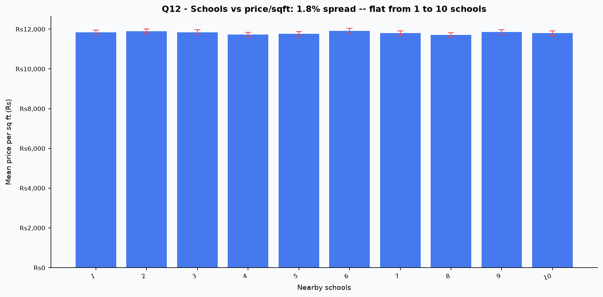

#### Q13: Nearby Hospitals vs Price
r = -0.0004. Flat across hospital counts (₹11,791 for 1 hospital vs ₹11,702 for 10 hospitals, 0.8% spread; across all counts 1-10 the full factor spread is 2.2%).

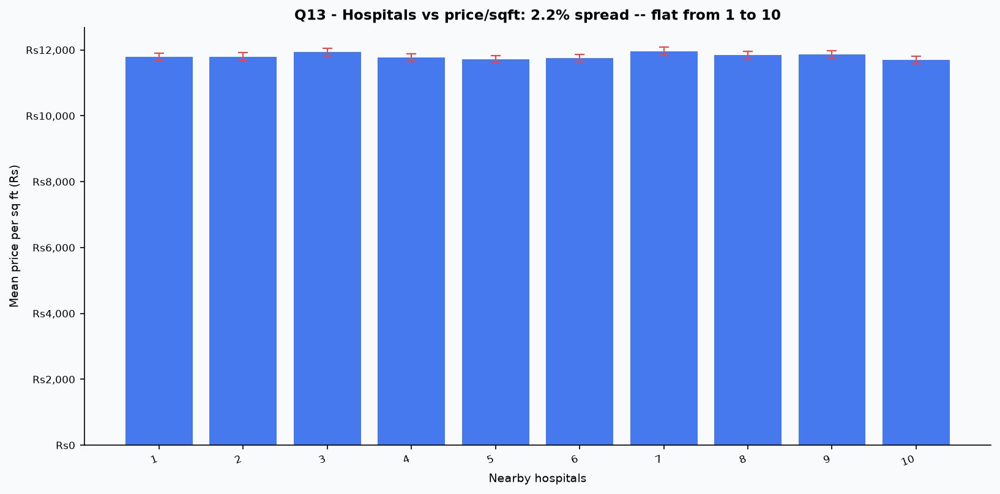

#### Q14: Price by Furnished Status
Furnished ₹245.72L, Semi-furnished ₹245.22L, Unfurnished ₹246.26L. 0.4% spread.

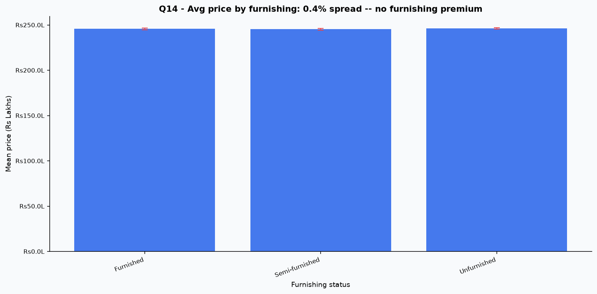

#### Q15: Price per SqFt by Facing Direction
East ₹11,797, North ₹11,793, South ₹11,790, West ₹11,878. 0.7% spread.

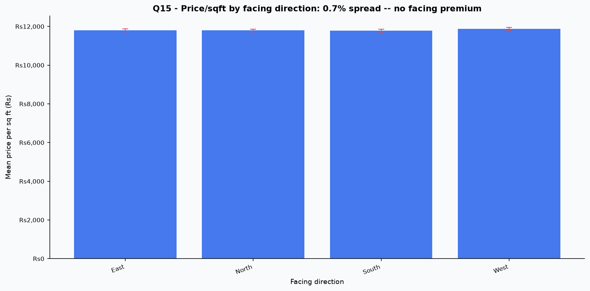

Take care with Q11: the 0.992 correlation is not a discovery. It reflects how the target was built.

### D. Ownership, availability and amenities (Q16-Q20)

#### Q16: Count by Owner Type
Broker 83,479 (33.4%), Owner 83,268 (33.3%), Builder 83,253 (33.3%).

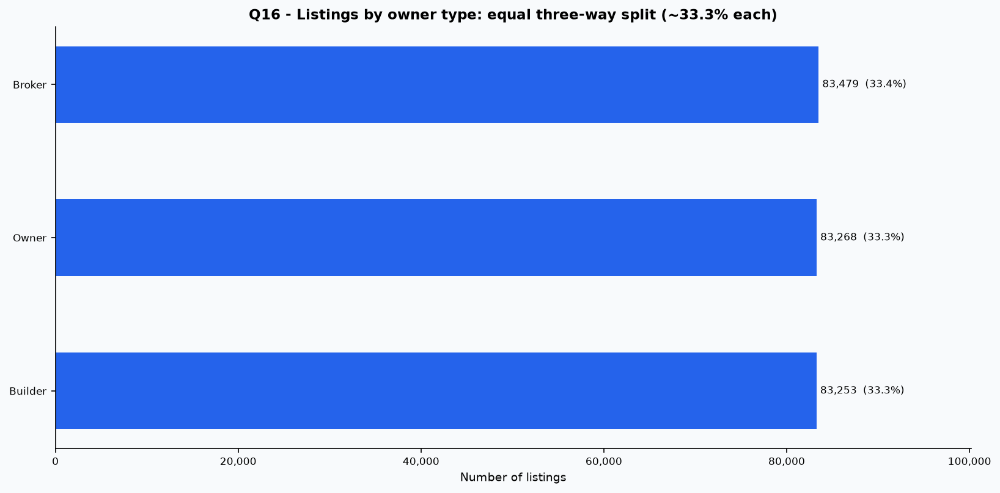

#### Q17: Count by Availability Status
Under Construction 125,035 (50.0%), Ready to Move 124,965 (50.0%).

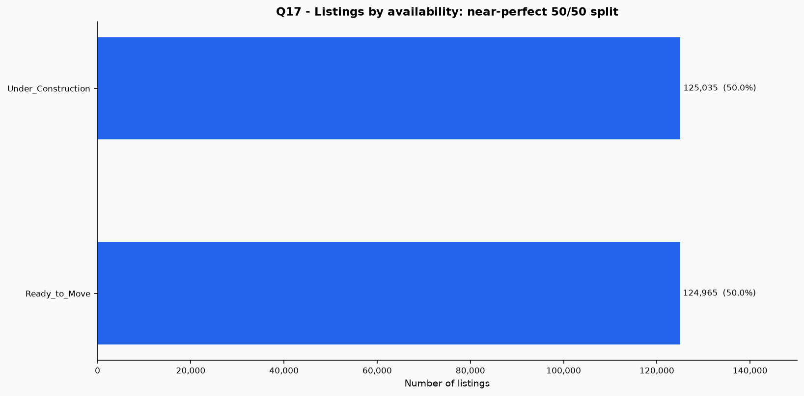

#### Q18: Parking vs Price
₹245.93L with parking (Yes) vs ₹245.55L without (No) (+₹0.38L, 0.2% spread).

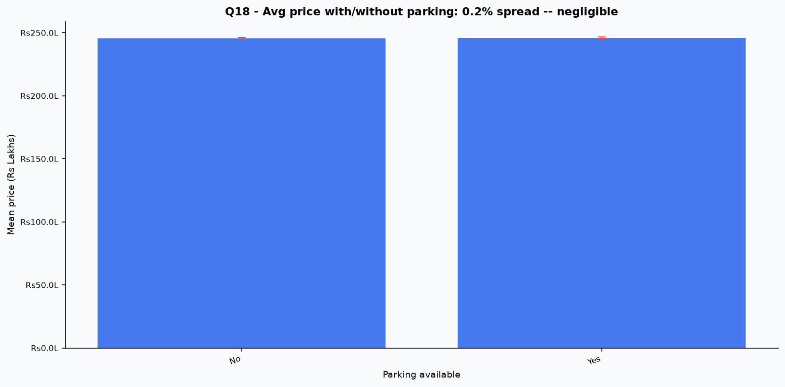

#### Q19: Amenities vs Price
₹11,803/sqft with 1 amenity, ₹11,854 with all 5. Flat (0.5% overall factor spread, 0.4% for 1 vs 5).

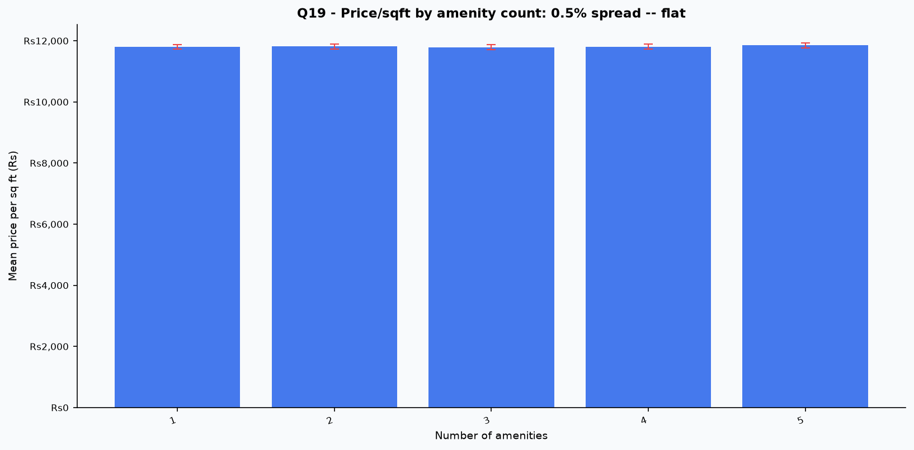

#### Q20: Transport vs Price and Investment Label
Price is flat (High ₹11,785, Low ₹11,842, 0.5% spread). Good Investment rate differs sharply: **42.5% for High access vs 7.3% for Low** (Medium: 25.8%).

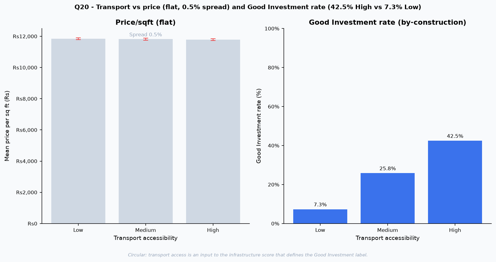

**Q20 is the only large difference in the whole EDA, and it is circular.** Transport accessibility is one of the three inputs to the infrastructure score that defines the Good Investment label, so High-access properties qualify more often by design. It shows the label rule working, not a market effect.

---

## 4. What actually varies in this dataset

1. **Price per sqft outliers (Q5):** 19,723 listings (7.89%) in raw data, caused by dividing independent uniform variables.
2. **Good Investment rate by transport access (Q20):** 42.5% High vs 7.3% Low, a by-product of the labelling rule.
3. **Price vs 5-year price (Q11):** r = 0.992, a by-product of how the target was constructed.

Everything else is within about 3% of flat.

---

## 5. Implications

**For modelling**
- Real predictive signal for price is close to nil, so any model's strength on these targets reflects the rules used to build them. The ablation in `reports/model_results.md` confirms this: removing price, size, schools, hospitals and city drops the classifier's ROC-AUC from 0.94 to 0.57.
- The 5-year regressor mostly relearns the growth formula (baseline R² 0.9822 vs model 0.9996).

**For business use**
- Treat the app as a decision-support demo for the rule set, not a market forecast. With real data, the same pipeline would be re-run on observed prices and transaction history.
- With real listings, the first things to check are whether size, city and infrastructure correlate with price. Here they do not.

---

## 6. Data notes and limitations

- **Category labels differ from the project brief.** Availability has only "Under Construction" (125,035) and "Ready to Move" (124,965) (the brief lists Available, Under Construction and Sold). Owner type is Broker (83,479), Owner (83,268), Builder (83,253) (the brief lists Individual, Builder, Agent). The Good Investment rule excludes "Sold" listings, but no listing has that status, so that condition has no effect.
- **Anonymised localities** (`Locality_207`) limit location analysis to the city level.
- **Floor data:** in the raw file, 116,304 of 250,000 rows had `Floor_No` above `Total_Floors`, which is far too many for real buildings. `Total_Floors` was raised to match, so floor-based features carry little meaning.
- **No price history:** the dataset has a single price per listing, so "price trends" (Q10) are cross-sectional by build year, not true time series.
- **Reference year:** property age uses 2026.
